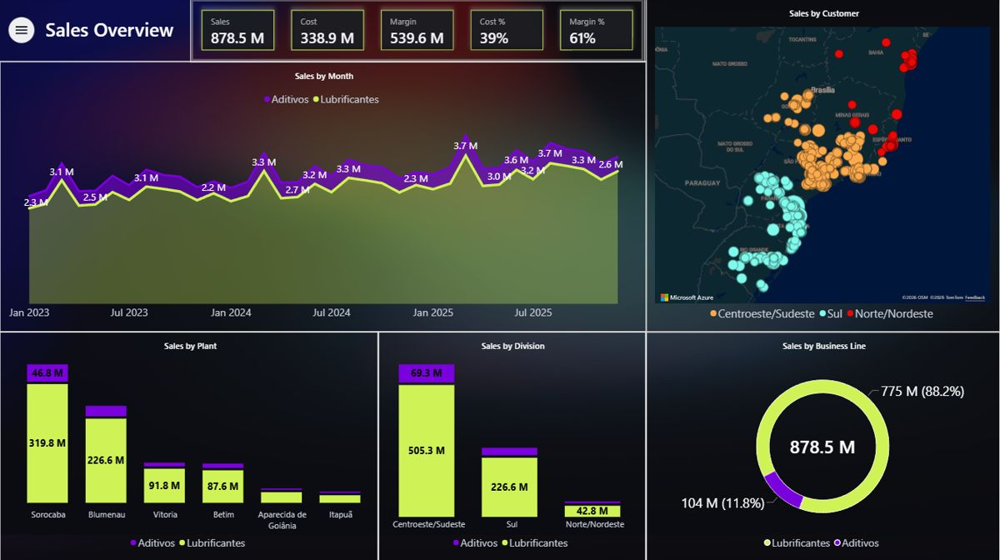

# Sales Overview · Power BI com DAX

Dashboard de vendas de uma indústria de **lubrificantes e aditivos** (2023 a 2025), com medidas DAX, formato dinâmico de números, página de detalhe e tooltip personalizado.

**[▶ Abrir o dashboard ao vivo](https://app.powerbi.com/view?r=eyJrIjoiMWZjYmVkZTEtNmMwNS00MGIzLThkNTUtODVkMzk5NTZjMDljIiwidCI6ImFmZjY0MmI3LTg1MTEtNGFhMi04ZGIyLThkMDE3MTI0Yjc5NyJ9)** · **[Portfólio](https://deivithmb.github.io)**

---

## Contexto
Vendas por **planta, divisão, região, cliente e linha de negócio**, de 2023 a 2025. O painel responde onde está a receita, qual é a margem e quem sustenta o resultado.

## Perguntas de negócio
1. Qual é o **faturamento, o custo e a margem** do período?
2. Como as vendas evoluíram **mês a mês**, por linha de negócio?
3. Quais **plantas** e **divisões** mais vendem?
4. Onde estão os **clientes** no mapa?
5. Qual o peso de **lubrificantes x aditivos** na receita?

## Ferramentas
Power BI Desktop · Power Query · DAX · Azure Maps · Power BI Service (Publicar na Web)

## O que foi construído
- **Tabela de medidas** (`# Medidas`) com Sales, Cost, Margin, Cost % e Margin %.
- **Formato dinâmico** em DAX (`SWITCH` + `SELECTEDMEASURE`), que mostra os valores em K, M ou B conforme o tamanho.
- **Coluna calculada** de mês (`Sales Month`) para a série mensal.
- **Página de detalhe** com a tabela de pedidos, acessível pela navegação do relatório.
- **Tooltip personalizado** com a tendência de vendas por divisão e por linha de negócio.
- **Mapa no Azure Maps** com os clientes por região.

## Principais números
| Indicador | Valor |
|---|---|
| Vendas | **R$ 878,5 mi** |
| Custo | R$ 338,9 mi (39%) |
| Margem | **R$ 539,6 mi (61%)** |
| Lubrificantes | 88,2% da receita (R$ 775 mi) |
| Aditivos | 11,8% da receita (R$ 104 mi) |

## Principais insights
- **Lubrificantes sustentam o negócio**, com 88% da receita.
- A divisão **Centro-Oeste/Sudeste** concentra a maior parte das vendas (R$ 574,6 mi), seguida do **Sul** (R$ 226,6 mi).
- **Sorocaba** é a planta líder (R$ 366,6 mi), à frente de **Blumenau** (R$ 226,6 mi).
- A margem fica estável perto de **61%**.

## Observação sobre os dados
Os mesmos números de pedido se repetem em anos diferentes, sempre no mesmo dia e mês. Isso indica uma **base sintética**, gerada para estudo. Numa base real, esse seria o primeiro ponto a investigar (duplicidade de pedidos).

## Arquivos
| Arquivo | Conteúdo |
|---|---|
| `sales-dashboard.pbix` | arquivo do Power BI (abre no Power BI Desktop, gratuito) |
| `images/` | prints do dashboard |

---
Projeto desenvolvido a partir do curso de Power BI de Bruce Fonseca. Os dados são fictícios.
**Deivith Rodrigues** · [LinkedIn](https://www.linkedin.com/in/deivith-rodrigues-655aa1142) · [Portfólio](https://deivithmb.github.io)
